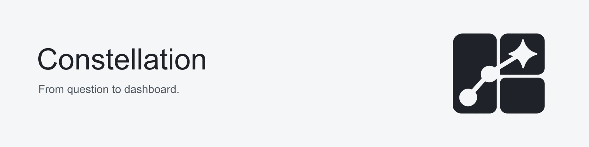

# Constellation

<picture>
  <source media="(prefers-color-scheme: dark)" srcset="assets/branding/exports/banner-compact-dark.png">
  
</picture>

A conversational canvas for creating and editing **Splunk Dashboard Studio** dashboards.

Describe an operational question, choose data available to your Splunk user, and watch a dashboard take shape. Select a chart, input or page to refine it through chat. Start from a blank canvas, an existing Studio definition, or an image/PDF reference when the selected provider supports it.

**Status: 0.37.0 development preview (unreleased).** This is a new codebase, separate from Splunk Dashboard Generator. It is not a production release or Splunk Cloud certified app. The repository is currently private and is being prepared for a future public release.

## Download and start

Get [Constellation 0.34.0](https://github.com/LeiterConsulting/constellation/releases/tag/v0.34.0), the latest published development preview. Repository access is required.

| Download | Use |
| --- | --- |
| [Splunk app · tar.gz](https://github.com/LeiterConsulting/constellation/releases/download/v0.34.0/constellation-0.34.0.tar.gz) | Install or update Constellation through Splunk app management. |
| [App and documentation bundle](https://github.com/LeiterConsulting/constellation/releases/download/v0.34.0/constellation-0.34.0-handoff.zip) | The same app, user guide, setup instructions and reviewed support/validation documents. |
| [Standalone user guide](https://github.com/LeiterConsulting/constellation/releases/download/v0.34.0/constellation-0.34.0-user-guide.md) | A walkthrough of creation, focused editing, drafts and native saves. |
| [SHA256SUMS](https://github.com/LeiterConsulting/constellation/releases/download/v0.34.0/SHA256SUMS) | Verify the downloaded files. |

1. Have an administrator install the app from file using the [installation guide](docs/installation.md). Refresh workspace tabs after an update; follow Splunk's reported restart requirements.
2. Open **Constellation → Settings**, configure OpenAI, Ollama or an administrator-approved AITK connection, and test the selected model. Keys stay in Splunk; no credentials are included in the release.
3. Choose **New dashboard**, select accessible Splunk data or an existing search, and describe the question. Select an element to refine it in chat. Check **Draft saved** before leaving; use **Save to Splunk** to create a normal private Studio dashboard.

Start with the [user guide](docs/user-guide.md). AITK administrators should follow the [setup guide](docs/aitk-setup.md); a passing small model test does not qualify every dashboard task or attachment type.

## What works today

- A live dashboard canvas beside one conversation panel that docks, floats and collapses.
- Native feature guidance from a versioned 29-type/822-option-entry renderer inventory; verified table sparkline styling and preserved imported properties. Full native parity remains a release gate.
- Real-data creation from accessible indexes/sourcetypes or an existing SPL/SPL2 search; instance-based starter suggestions.
- Native Studio pages, page purposes, table drilldowns, device/entity tokens and return navigation.
- Element selection for directed chat edits and contextual suggestions.
- Exact selected-table sorting and return-button label edits with native preservation; broader requests retain model authoring.
- Field meanings and recorded units supplied in chat, kept with the selected data source; sample-only missing/numeric/multivalue evidence informs questions and follow-ons.
- Private, Splunk-backed drafts with conversations, a persistent dashboard brief, refresh/reopen, rename, duplicate and recoverable Trash.
- Atomic validated edits, bounded automatic repair, live stage receipts, elapsed time, cooperative Stop, current-session undo/redo and durable dashboard version history.
- Studio JSON import/export and private native copies in a chosen Splunk app, verified by reading their definitions back.
- OpenAI, Ollama and named Splunk AI Toolkit (AITK) connections behind separate provider adapters.
- Image/PDF input guarded by the exact selected model's verified capabilities.

This app remains self-contained inside Splunk: React/TypeScript, the Splunk Dashboard Framework, Splunk UI Toolkit and bundled Python REST handlers. It requires no separate agent platform, worker service or vector database. Retrieval currently uses bundled, attributed guidance filtered by version and intent; semantic RAG and verified cross-dataset relationships remain future work.

## Current development

- **More → Images and icons** uploads/reuses native raster images and passive SVG icons without sending file bytes to models. **Export with assets** and **Dashboards → Import dashboard file** move supported shared media between instances, with explicit sharing review and verified reference remapping. Native upload permissions apply. Reports, lookups, packaged files and external media remain separate dependencies.

- Geographic layers and SVG source roles receive bounded checks. Small explicit new map/SVG boards use compiled source bindings and layout; the verified base search stays on the server. Native geographic read transforms retain the existing guards.

- Native type/option release boundaries are separate from the embedded renderer. New unavailable features are rejected; imported configurations remain intact and receive a preview notice.
- Specialized chart source roles, ordered numeric axes, time bindings and supported events receive actual-output validation. Bounded native-chart creation uses a smaller plan while retaining every final check.
- Versioned structural contracts and attributed native recipes reach the agent using the request, selected element and durable Draft requirements. Smaller creation/editing paths retain relevant guidance.
- Native table sparklines can be created alongside scalar aggregates and styled across every row through verified selected-column edits. Actual array output is checked before styling.
- Missing-value behavior follows the native target: older Studio asks for a trend chart or explicitly accepted, labelled zero fill; supported newer-target queries preserve missing buckets and genuine observed zero separately.
- Advanced source bindings, table cell options and known missing native object containers receive targeted validation without dropping unknown imported properties.
- Saved-report references and chains can be inspected and previewed through bounded current-user searches. Selected report-backed panels supply their own profiling context; native scheduled-cache, execution-permission and app-context differences remain explicit.
- Reset defaults, restored selections and unset input state stay distinct across preview refreshes. New unset actions are gated to qualified 10.4+ targets; installed extension discovery reads metadata only.

The [native coverage ledger](docs/native-coverage.md) separates the authoring inventory from features exercised end to end. Complete Studio parity remains open.

See the [changelog](CHANGELOG.md) for version history and [validation](docs/validation.md) for exact package hashes, tested journeys and retained failures.

## Compatibility and boundaries

Selected flows have been exercised on Splunk Enterprise **10.2.8** with Studio **1.23.12**, and Enterprise **10.4.4** with Studio **1.26.6**. These are observed test targets, not a guarantee of full feature parity across every Splunk release or deployment topology. The Environment dialog checks the actual instance's versions, permissions and SPL2 execution surface.

Search previews use the current user's permissions and a read-only command subset. They are bounded to a selected 15-minute, 1-hour, 24-hour or 7-day window, at most **200 rows / 5 seconds per query**, and eight sources in the preview. Tracked jobs label completed queries, partial output, failures and stale snapshots. Counts and aggregates can still be partial; a completed query is not proof of analytical correctness. Preserve the distinction between native Studio rendering, bounded preview results and a validated dashboard definition.

Multi-page actual-data creation and focused edits have been exercised through OpenAI, Ollama and AITK. Earlier AITK qualification verified a 16,000-token budget; a 2,000-token setting could return no completion. The app does not query or infer its current upstream model/token limits. Settings distinguishes a small connection test from full authoring and exposes reported or unknown limits. Compact creation reduces avoidable output while retaining all validation gates. These are bounded provider/model/environment checks, not a general success-rate or 1.0 acceptance claim.

The [latest qualification](docs/validation.md#0370-svg-icons-and-portable-assets--october-28-2026) records portable media transfer, native rendering, ordinary-user provider journeys and the exact development package. Readback, browser rendering and offline validation are reported separately. These operated samples remain separate from unaided-user or general reliability acceptance.

**Before 1.0:** historical latency tails, broader model/native/imported/SPL2 and complex measurement semantics, independent delivery/storage security review, fresh-install/upgrade/rollback/cluster testing, unaided UX/accessibility and bundle reduction remain open. AITK on the second tested target remains blocked by maintainer permissions. See the [release gates](docs/roadmap.md), [support contract](docs/studio-support.md) and [qualification protocol](docs/provider-qualification.md).

## Development

Use Node.js 22/npm and Python 3.13. Backend compatibility is also tested on Python 3.9.

```sh
npm ci
npm test
python3.13 -m unittest discover -s tests
npm run build
python3.13 scripts/package_app.py
npm run dev -- --port 5178
```

The local preview demonstrates the canvas with illustrative data. Provider settings, live searches, server-backed drafts and native saves require the installed Splunk app. Packaging creates `artifacts/constellation-0.37.0.tgz`; release `.tar.gz` assets contain those exact bytes. Build artifacts and dependencies stay outside Git. See [development and release checks](docs/development.md).

## Data and credentials

Direct OpenAI keys configured in Constellation use an owner-only Splunk handler and encrypted credential store with owner-restricted app ACLs. Ordinary authors need no credential-store capability; the handler stores and uses only their own key and never returns it. Saved keys are not returned to the form or stored in browser storage. AITK retains custody of its own credentials; shared inference does not return them to authors. Splunk administrators retain credential-management authority.

The selected provider receives the prompt, recent conversation, dashboard definition/SPL and verified field metadata, plus supported attachments submitted with the message. Search result rows stay in Splunk and the browser. Definitions, searches, conversations and attachments can still contain sensitive information: review your provider and organizational policies before use. AITK prompt-bearing searches retain normal Splunk search-job/history behavior. Read the [security and data-flow guide](SECURITY.md) before connecting an external provider.

## Documentation

| Guide | Purpose |
| --- | --- |
| [Installation](docs/installation.md) | Build, install, configure and start a real-data dashboard. |
| [Providers](docs/providers.md) | OpenAI, Ollama, AITK and attachment boundaries. |
| [AITK setup](docs/aitk-setup.md) | Administrator setup, author permissions and native connection tests. |
| [Security review](docs/security-review.md) | Independent agent review, fixes and limits. |
| [Architecture](docs/architecture.md) | App modules, request flow, persistence and security boundaries. |
| [Native coverage](docs/native-coverage.md) | Native authoring inventory and explicit parity gates. |
| [Studio support](docs/studio-support.md) | Implemented behavior and remaining parity gates. |
| [Development](docs/development.md) | Local commands, synthetic fixtures, CI and repository checks. |
| [Validation](docs/validation.md) | Verified test scope and explicit limitations. |
| [Task benchmark](docs/model-benchmark.md) | Weighted synthetic checks and evidence for model workload/batching decisions. |
| [Provider qualification](docs/provider-qualification.md) | Repeated core journey, analytical probes and the 1.0 decision. |
| [Upgrade guide](docs/upgrade-guide.md) | Compatibility profiles, provider adapters and draft migrations. |
| [Product direction](docs/product-direction.md) | Interaction principles and product goals. |
| [Roadmap and release gates](docs/roadmap.md) | Work required before broader/public release. |
| [Contributing](CONTRIBUTING.md) | Changes, tests and safe reports. |

Private lab screenshots, raw diagnostic receipts, environment-specific automation and the separate exploratory prototype remain outside Git. The repository contains the app source, tests and explicitly synthetic fixtures. See [repository publication rules](docs/development.md#repository-publication-checks).

## Licensing

An open-source license has not yet been selected; no open-source license grant is made for the first-party code at this stage. License selection and dependency redistribution review are public-release gates. Dependencies retain their own licenses; packaging collects available runtime license texts and third-party notices. Splunk and provider names identify integrations and do not imply endorsement.
