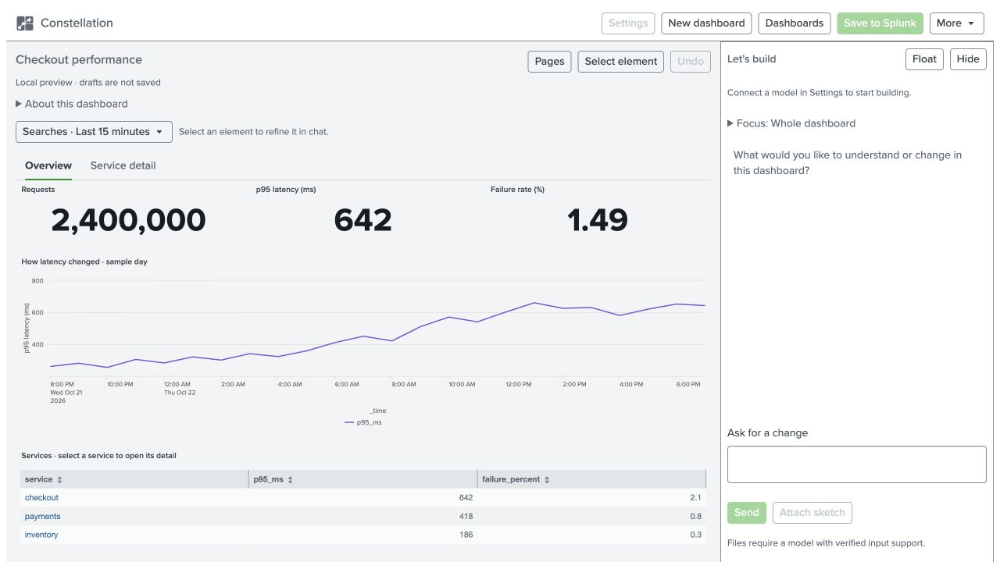

# <picture><source media="(prefers-color-scheme: dark)" srcset="assets/branding/exports/mark-dark-48.png"></picture> Constellation

Create and edit **Splunk Dashboard Studio** dashboards through a conversation beside a live canvas. Choose data your Splunk account can search, refine a selected chart or input, and save a normal native Studio dashboard.

**Version 1.0.1** · [Download](https://github.com/LeiterConsulting/constellation/releases/tag/v1.0.1) · [User guide](docs/user-guide.md) · [Documentation](docs/README.md)

**New in 1.0.1:** previews follow the active page, reuse fresh results and cancel obsolete work. Draft-save receipts distinguish uncertain delivery from genuine conflicts. [Release evidence](docs/validation.md#101--october-30-2026) records the bounded three-provider checks.

## Start here

1. **Install:** have an administrator install the release archive using the [installation guide](docs/installation.md).
2. **Connect:** open **Settings**, configure OpenAI, Ollama or an approved AITK connection, and run **Test model**.
3. **Build:** choose **New dashboard**, inspect accessible Splunk data and describe the question. Select an element to refine it in chat.
4. **Keep and use:** wait for **Draft saved** to resume later. Choose **Save to Splunk** for a new private native dashboard.

<picture>
  <source media="(prefers-color-scheme: dark)" srcset="docs/images/workspace-docked-dark.jpg">
  
</picture>

*Actual 1.0 interface in the local preview, using the built-in synthetic example. No model is connected. Provider calls, persistent drafts and native saves require the installed Splunk app. [Screenshot provenance](docs/screenshots.md).*

## What you can do

- Start with an empty canvas, import Studio JSON, or reopen a private draft and its conversation.
- Create pages, charts, tables, inputs and drilldowns; focus chat on a chart, input or page.
- Inspect fields and sample coverage while editing. Keep units, exclusions and requirements in the dashboard brief.
- Use docked or floating conversation, contextual follow-ons, progress updates and a Stop control.
- Attach an image or PDF when the configured route and exact model support it.
- Upload supported native artwork and move compatible dashboard assets, reports, CSV lookups and macros between instances.

Constellation runs inside Splunk. It does not require a separate agent service or vector database.

## Downloads

| File | Purpose |
| --- | --- |
| [Installable app](https://github.com/LeiterConsulting/constellation/releases/download/v1.0.1/constellation-1.0.1.tar.gz) | Install or update through Splunk app management. |
| [App and documentation bundle](https://github.com/LeiterConsulting/constellation/releases/download/v1.0.1/constellation-1.0.1-handoff.zip) | The same app, user guide, screenshots and administrator/reference material. |
| [User guide · Markdown](https://github.com/LeiterConsulting/constellation/releases/download/v1.0.1/constellation-1.0.1-user-guide.md) | Standalone guide text. The bundle includes its local images. |
| [User guide · PDF](https://github.com/LeiterConsulting/constellation/releases/download/v1.0.1/constellation-1.0.1-user-guide.pdf) | Illustrated guide for reading or printing. |
| [MIT license](https://github.com/LeiterConsulting/constellation/releases/download/v1.0.1/LICENSE) | First-party license accompanying the app and documentation. |
| [Dependency notices](https://github.com/LeiterConsulting/constellation/releases/download/v1.0.1/constellation-1.0.1-third-party-notices.zip) | Upstream notices, also embedded in the app and included in the handoff. |
| [SHA256SUMS](https://github.com/LeiterConsulting/constellation/releases/download/v1.0.1/SHA256SUMS) | Verify every release download. |

## Supported scope

The 1.0 profile is a **single Linux Splunk Enterprise search head**. Recorded targets are Enterprise **10.2.8 / Studio 1.23.12** and **10.4.4 / Studio 1.26.6**. OpenAI, Ollama and AITK 6.1/6.2 have bounded ordinary-author qualification; this is not a guarantee for every model or configuration.

Previews run a guarded read-only search subset as the current user, within fixed time and result limits. Partial or stale snapshots are labelled. Native saved dashboards retain normal Splunk execution and permissions. Complete Studio parity, Cloud certification and search-head-cluster coordination are outside the 1.0 profile.

See [supported features and limits](docs/studio-support.md), [security and data flow](SECURITY.md) and [release evidence](docs/validation.md). A small model test does not establish dashboard correctness.

## Find your next step

| You want to… | Read |
| --- | --- |
| Create, refine, reopen or publish a dashboard | [User guide](docs/user-guide.md) |
| Configure Splunk, providers or shared AITK | [Installation](docs/installation.md) · [Providers](docs/providers.md) · [AITK setup](docs/aitk-setup.md) |
| Understand sharing and portable files | [Assets and portability](docs/assets-and-portability.md) |
| Resolve a problem or report a bug | [Troubleshooting](docs/troubleshooting.md) · [Support and updates](docs/support-policy.md) |
| Build or contribute | [Development](docs/development.md) · [Architecture](docs/architecture.md) · [Contributing](CONTRIBUTING.md) |

## Licensing

Constellation's first-party code and documentation are licensed under the [MIT License](LICENSE), copyright 2026 Leiter Consulting. Third-party components retain their own licenses. The app embeds the MIT license and [dependency notices](third_party/README.md); keep them with redistributed copies. Splunk and provider names identify integrations and do not imply endorsement.
