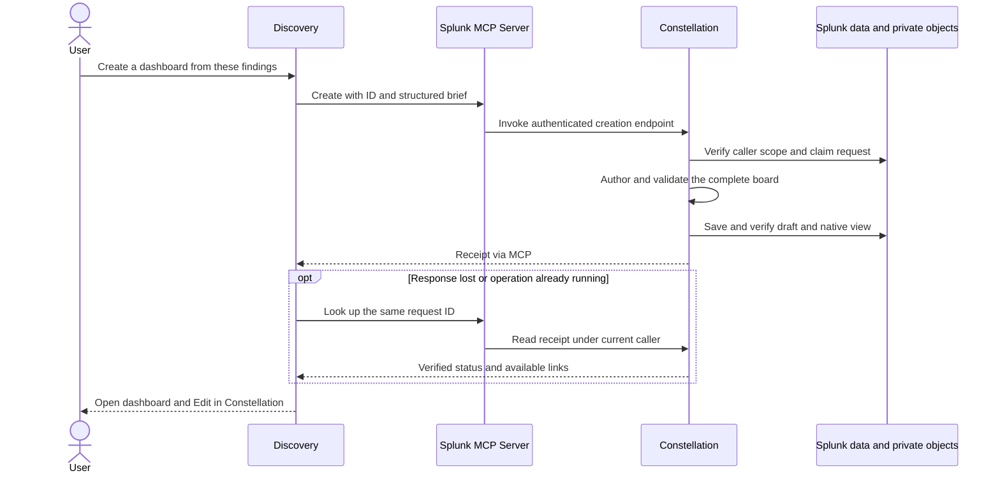

# Constellation MCP dashboard creation design

Design proposal · November 20, 2026 · Baseline Constellation 1.0.2

The first pilot is one ordinary Splunk author using Discovery Tool to create a small live dashboard from a conversation or report. Both links should work in Splunk Web immediately after verified creation. The same request should return the same artifacts after the client reconnects. The [shared contract](mcp-dashboard-contract.md) defines the inputs, states and links. The [Discovery handoff](splunk-discovery-tool-handoff.md) defines client implementation and acceptance.

## Registration and identity

The initial design used `default/tools.conf` and `static/tool_input_payload_signatures.json` for App Manager registration. Preview 2 uses those declarations to generate the [separate management API payload](mcp-dashboard-pilot.md#register-the-mcp-tools). The dedicated authenticated REST endpoints remain the execution boundary. The general authoring endpoint and both privileged provider handlers stay outside the tool catalog. Create uses POST. Status uses GET and maps its three scalar arguments to the query string.

App Manager can register packaged tools and administrators can enable the registered entries. Check both visibility and role mapping. Keep the feature disabled at the handler until an administrator enables creation for the pilot role. Define a narrow authorization capability and require normal search and private-object write permissions for creation. A read-only status request requires the corresponding pilot authorization and ownership. Keep registration/admin rights out of ordinary author roles. Custom tool registration and enablement are independent from authorization inside the handlers. [Splunk app tool registration](https://dev.splunk.com/enterprise/docs/devtools/splunkmcp/addmcptoapps) · [Splunk custom tool management](https://help.splunk.com/en/splunk-enterprise/mcp-server-for-splunk-platform/1.2/managing-custom-tools-in-splunk-mcp-server)

The prerequisite is observed caller continuity from an ordinary user's MCP connection through the custom REST endpoint to Splunk search, draft and view authorization. Compare `passSession` with Splunk's current-context identity under the forwarded session. Verify search restrictions and both resulting object ACLs using two distinct users. Refuse absent or mismatched identity before reserving the ID or exposing a receipt. Compare the configured `expected_user` assertion against the authenticated caller and keep it separate from authorization. MCP tokens are scoped to the gateway. The endpoint obtains its actual runtime session from Splunk. An owner string, shared profile, system session, or administrator credential cannot stand in for the human. Existing isolated provider helpers may perform their bounded inference role, while the searches and saves use caller authority. [Splunk MCP connection and token behavior](https://help.splunk.com/en/splunk-cloud-platform/mcp-server-for-splunk-platform/2.1/set-up-and-connect-to-splunk-mcp-server/connecting-to-the-mcp-server-and-settings)

## Server work

1. Add a small creation service composed from the existing user-scoped runtime. Normalize the structured brief into a blank Studio definition, authorized `dataContext` and durable editorial brief. Screen report findings as context and require the user-selected range. Resolve saved reports by exact name and app under the requesting author. Start with index and guarded SPL scopes and qualify saved-report persistence separately within the same contract.
2. Reuse `AgentService.assist` from [agent_service.py](https://github.com/LeiterConsulting/constellation/blob/0a8cedfb87f6ba1a57578f2fe3a4e4e875d830d5/splunk/constellation/bin/agent_service.py) and `apply_changes` from [studio_contract.py](https://github.com/LeiterConsulting/constellation/blob/0a8cedfb87f6ba1a57578f2fe3a4e4e875d830d5/splunk/constellation/bin/studio_contract.py). Treat model output, panel descriptions and findings as data. Enforce the requested page and panel coverage along with existing shape, scope, search, dependency and preview checks. A no-change response can map to `needs_input` only when there is an actionable question. Before any provider call, check the actual configured provider route against an administrator-controlled pilot allowlist. Discovery’s provider setting alone offers no assurance about Constellation’s route. Return controlled warnings for partial search evidence. Keep the existing per-turn inference and search limits.
3. Persist the verified Studio candidate via [draft_service.py](https://github.com/LeiterConsulting/constellation/blob/0a8cedfb87f6ba1a57578f2fe3a4e4e875d830d5/splunk/constellation/bin/draft_service.py). Use the existing snapshot schema. Preserve the purpose, requirements and brief provenance through ordinary workspace fields. Save a short initial conversation containing the minimized request and result. Record the source scope and page purposes so the workspace can continue editing. Use the existing exact write/readback safeguards and avoid taking over the user's active draft pointer just because an external operation ran.
4. Add a server-side fresh native save service that serializes the Studio v2 envelope, creates as the caller in the Constellation app and reads back the parsed definition, owner, app and private sharing. [The browser currently implements this write](https://github.com/LeiterConsulting/constellation/blob/0a8cedfb87f6ba1a57578f2fe3a4e4e875d830d5/src/api.ts), and [the dashboard library](https://github.com/LeiterConsulting/constellation/blob/0a8cedfb87f6ba1a57578f2fe3a4e4e875d830d5/splunk/constellation/bin/dashboard_library.py) already has a server-side view parser and restore paths. Use shared synthetic XML/definition cases to keep the two entry points aligned before considering a browser refactor.
5. Generate the editor route from the verified draft ID using the [existing workspace routing](https://github.com/LeiterConsulting/constellation/blob/0a8cedfb87f6ba1a57578f2fe3a4e4e875d830d5/src/pages.ts). Generate the native route from the verified app and view identifiers. Set the administrator-configured Splunk Web base explicitly on the pilot instance. Validate scheme, host, port, prefix and locale. Use path/parameter encoding and reject credentials, query strings and fragments in that base. Links can survive a proxy or port difference between the MCP and human-facing endpoints.

## Execution and recovery

Use a bounded synchronous create handler for the pilot. Keep the verified caller session in the active request. Give status a separate short-running handler and verify it remains responsive while inference runs. Discovery may dispatch create as an in-flight application task and poll status. A synchronous request may die on disconnect, so measure the installed proxy, MCP and Splunk handler deadlines and observe disconnect behavior. Enable the pilot only when its small workload fits the measured deadline or completes reliably after a client disconnect. The app's 240-second **browser** delivery window is a reference for the experiment, and the MCP timeout must be measured independently. A longer discovery-client timeout alone cannot fix a shorter server limit. [Browser delivery window](https://github.com/LeiterConsulting/constellation/blob/0a8cedfb87f6ba1a57578f2fe3a4e4e875d830d5/src/authoringRun.ts)

For future background execution, first establish a Splunk-supported mechanism that runs searches and saves with the requesting user's revocable authority. A queue populated by a request does not establish that authority. No caller session or MCP token belongs in job/receipt storage. Keep the shared implementation inside the Splunk app and qualify the first pilot on a single search head.

Use a persistent operation ledger with a per-owner/per-ID atomic claim, app-controlled mutations, bounded storage and owner-only readout through the status service. Prefer a single-head store and cross-process claim modeled on existing locked draft persistence. Verify actual ACLs, who can alter ledger contents outside the handler, and how the store handles restart before committing to private configuration or KV Store. The request digest, owner binding, generated immutable draft/view IDs, stage transitions and expected artifact digests are the minimum durable state. Store a bounded safe receipt. Treat ledger state only as a locator for caller-scoped readback when confirming artifacts.

- Commit and verify the claim before inference. A concurrent duplicate can see progress without starting a second execution. Keep the claim lock out of slow inference and search.
- Set the expected write identity and digest before each artifact write. Commit the draft before creating the view. Read both back under caller authority before emitting `created`.
- A confirmed native failure gives `draft_only` when a verified draft exists. After an uncertain write, inspect the preassigned identities and expected content. Return `indeterminate` if the outcome cannot be proven. The status handler can check and report an already committed write under the current caller. It performs no provider call or artifact write.
- A restart or expired in-flight lease prevents the handler from issuing new writes. Use the operation lock for each transition that checks the lease and starts a write. A write already issued may still commit and requires readback. A response timeout leaves the original request ID recoverable. A retry cannot generate a new draft or view with that ID. A late reply or later exact readback may establish success only when identity and both expected artifacts are proven. Retain an uncertain artifact for reconciliation.
- A peer requesting someone else's ID receives the same response as a missing receipt. Object existence, current ownership, app and sharing are checked again before returning links. A user's legitimate edits after creation do not invalidate the earlier success receipt. Expiring receipts cannot expire dashboards or drafts.

## Qualification sequence

| Gate | Evidence to collect |
| --- | --- |
| Registration and transport | Check install/manual registration, enablement, actual catalog names, both argument maps and typed result/error envelopes. Round-trip quotes, backslashes, Unicode and literal dollar signs. Measure tool deadline and status responsiveness on the chosen versions. |
| Identity and ACLs | Ordinary author A can search only the allowed data, create exactly two private artifacts and open both links. Ordinary author B cannot retrieve A's receipt or edit either artifact. Verify that shared credentials, revoked access, disabled tools and stale profile bindings fail safely. |
| Authoring and opening | Start with a small index-backed board. Open Studio and verify native rendering. Open the draft, inspect its brief and continue editing. Repeat with a report-derived brief. Enable saved-report source references after their native execution and permission behavior passes. |
| Recovery | Induce same-ID concurrency, disconnect and response loss, process restart around each save, readback failures, and changed arguments. Verify object counts and ownership, retained draft on native failure, no duplicate inference, and no links to unverified objects. |
| Privacy and diagnostics | Check provider-bound payloads with a synthetic forbidden marker, Discovery Incognito denial and minimal logging on each side. Inspect ordinary-user storage, URL validation and expiry; test cleanup of receipt metadata independently of artifacts. |
| Release | Run the app's normal tests, packaging checks and AppInspect. Record the actual Enterprise, Studio and MCP Server versions, tool names, wrapper formats, timeouts, identities and observed failure cases. |

Use a separate future version for multi-source briefs, supplied plans that can skip inference, background jobs, updates to existing native views and sharing. Each changes the execution or permissions contract and needs its own qualification.
