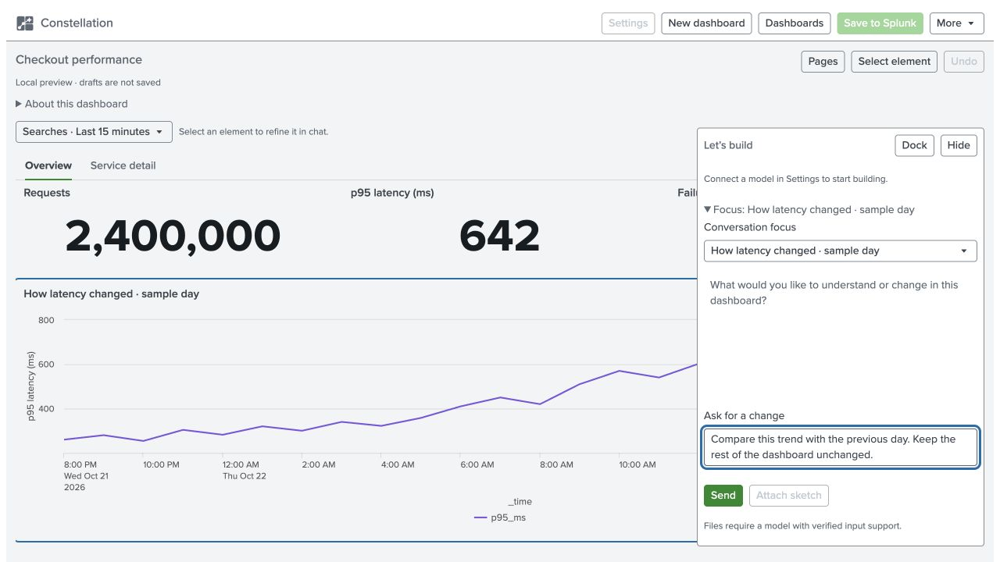
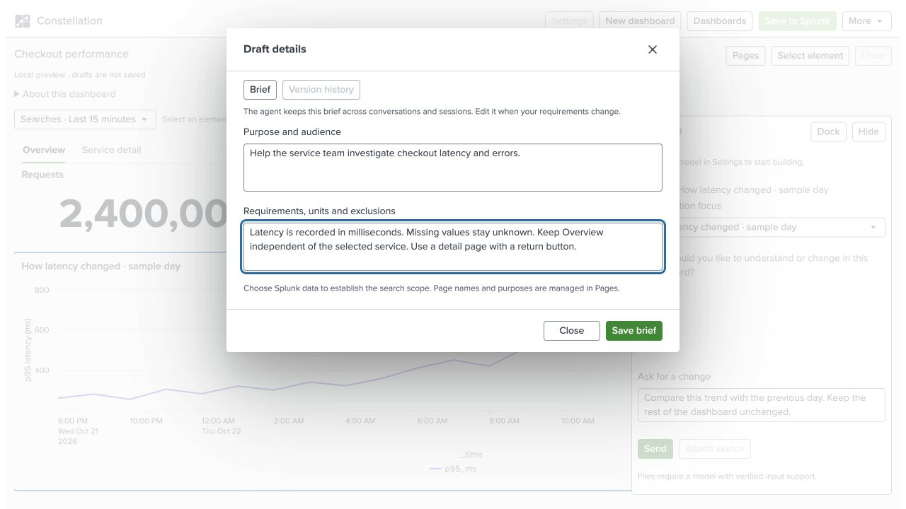

# Constellation user guide

Create a dashboard from a question and Splunk data, refine it through chat, and save a native Dashboard Studio copy. This guide describes version **1.0.1**.

**Before you begin:** Constellation must be installed in Splunk, your account must be able to search the chosen data, and a provider must be configured. If **Settings** or **Test model** needs attention, follow [provider setup](providers.md) or ask your administrator.

**In this guide:** [Build](#build-your-first-dashboard) · [Refine](#refine-a-chart-input-or-page) · [Keep context](#keep-context-with-the-dashboard) · [Pages](#create-pages-and-navigation) · [Resume](#save-reopen-and-restore) · [Native output](#use-the-result-in-splunk) · [Files](#use-an-image-or-pdf-reference) · [Help](#when-a-step-does-not-complete)

*Screenshots use the actual local UI and authored sample data. They do not show a live provider connection, saved private draft or production data. Installed-only actions are disabled in the local preview. [Image details](screenshots.md).*

## Build your first dashboard

1. Choose **New dashboard**. This opens an empty canvas; it does not modify the example board or another draft.
2. Under **Start with your Splunk data**, choose a starting question, **Choose Splunk data**, or **Use an existing search**. Starter questions come from a bounded inspection of recent accessible datasets. Choosing a question fills an editable request; review it before **Send**.
3. Choose the dataset or existing SPL/SPL2 search and a time range. Use **Inspect fields** to check names, meanings, units and sample coverage. A field absent from a bounded sample is not necessarily absent from the dataset.
4. Describe the outcome, audience and rules. Use the inspected field names. For example:

   > Use the selected data to show latency over time and a service summary. Latency is recorded in milliseconds. Keep missing measurements unknown and show how many observations support each average.

5. Choose **Build dashboard** from data inspection, or **Send** from the conversation. Watch the stage and elapsed time. Changes apply together after validation; rejected changes leave the accepted dashboard intact.

Review the result before relying on it: titles, units, time ranges, empty values, calculations and drilldowns. The preview is bounded. **Partial** is not a complete count, and **snapshot** does not mean continuously live.

## Refine a chart, input or page

Turn on **Select element** and choose an element on the canvas. Alternatively, expand **Focus** in the conversation and choose an item from **Conversation focus**. Check the displayed target before sending a focused request.

> Change only this table: round latency to one decimal and keep its existing columns and row links.

**Keep exploring** offers follow-on requests. Selecting one fills the composer; you can edit it before sending. A suggestion is a proposed next step, not proof of a relationship in the data.

Choose **Float** to move the conversation over the canvas, **Dock** to return it beside the canvas, or **Hide** to collapse it. **Show conversation** opens it again.

*The selected chart and prompt are illustrative. The prompt shown has not been sent to a model.*

## Keep context with the dashboard

Use **More → Draft details and history → Brief** for instructions that should remain with this draft: purpose, audience, recorded units, exclusions and conventions. Choose **Save brief**. The brief remains part of the draft when you switch providers or reopen it.

> Latency is recorded in milliseconds. Missing values stay unknown. Keep Overview independent of the selected service. Include a detail page with a return button.

*Example brief in the local UI. Durable storage requires the installed Splunk app.*

To revisit fields while editing, select the chart or input, open the **Searches** or dataset button above the canvas, then choose **Choose Splunk data** or **Data: …**. Expand **Field context**. Inspection follows the selected primary source, current input values and the original report app when applicable.

Explain recorded units explicitly. A name hint is not evidence of a physical unit. If the agent asks for a unit, answer for the named field; requesting a display conversion is a separate instruction. Changing the source establishes new context; changing only the time range keeps field definitions.

## Create pages and navigation

Use **Pages** to add or rename a page and give it a purpose. Page purposes help organize the conversation; they do not create an access boundary.

For linked pages, name the source, destination and filter:

> Create Overview and Service detail. Keep Overview unfiltered. Clicking a service in the summary should open Service detail filtered to that service. Add a return button to Overview.

Check the default view, at least two selections where data permits, and the return action. Ask explicitly which detail charts should filter. Use native Studio to verify the saved interactions.

For dependent inputs, describe the parent and child choices. Native cascading reset is version-gated; earlier targets can use dependent searches with separately configured resets. An unset required input waits for a choice rather than inventing results.

Previews follow the active page, including its charts, page inputs and global inputs. Switching pages cancels obsolete preview work. Fresh unchanged results can be reused for up to one minute; use the dataset/time menu's **Refresh searches** for current results. Each page previews up to eight consumer sources, with 200 rows and five seconds per query. Use **Search details** for partial, waiting, failed or stale evidence, and native Studio when a page exceeds the preview limit.

For a table trend, ask for a **native sparkline column** alongside scalar metrics. Older Studio targets render missing sparkline buckets as zero; Constellation asks whether to accept labelled zero fill or use a separate trend chart. Review [native coverage](native-coverage.md#tables-and-sparklines) before interpreting gaps.

## Save, reopen and restore

Drafts save privately in Splunk with their conversation, brief, selected data, page/input state and pending attachments. Wait for **Draft saved** before leaving.

| Task | Action |
| --- | --- |
| Reopen a draft | **Dashboards → My dashboards**, then choose its title. |
| Rename or keep a separate copy | Use **Rename** or **Duplicate** beside the draft. |
| Recover a deleted draft | **Dashboards → Trash → Restore**. The conversation is retained. |
| Restore a document version | **More → Draft details and history → Version history**. The current conversation remains. |
| Undo the current session's edit | **Undo**; use **Redo** when available. |
| Reopen the same page and focus | **More → Copy draft link**. The link still requires the owning user. |

During **Saving draft…**, small pending changes can recover within the same tab's storage limits. **Keep this tab open until saved** means you should wait before refresh or closure. The tab copy expires after six hours and is not a backup across closed tabs. A conflict preserves local work and offers a separate copy.

An uncertain save is checked against its exact stored state and revision before being confirmed. For a genuine conflict, choose **Save as new draft** to keep both versions. **Save details** expands to show the save stage, revisions and operation ID; include those controlled details when reporting a problem, without sharing the dashboard's content.

Opening a missing, deleted or another user's draft does not create a replacement. Use **Dashboards** or deliberately choose **New dashboard**.

## Use the result in Splunk

1. Choose **Save to Splunk**.
2. Select a destination app your account can use.
3. Choose **Save private copy**.
4. Open the result in native Studio and check the searches, ranges, layout and interactions.

This creates a **new private native dashboard** and verifies its definition by readback. Saving the working draft does not update a previously saved Studio copy. The native result can be edited or shared through normal Splunk controls; sharing authority and data/dependency access still apply.

Constellation lists Studio dashboards saved in its own app. Copies saved in another app appear in that app's dashboard list. Import Studio JSON or open an accessible Constellation view to begin editing an existing dashboard as a draft.

Private native views managed in Constellation have recoverable delete/restore. Shared native views can be opened or duplicated; Constellation does not rename/delete them. Restore refuses to overwrite an existing view ID.

## Use an image or PDF reference

Use **Attach sketch or PDF** when available, describe whether it supplies layout or content, and choose **Send**. A reference helps describe the layout; it does not verify the real data or field meanings.

At most **two files, 4 MB each** are accepted. OpenAI image/PDF support depends on an exact recognized model ID. Ollama images require advertised vision support; its PDF route is blocked. AITK is text-only. Unknown support blocks file transmission. See [provider and file support](providers.md#reference-files).

Attachments can remain in the private draft. Review their content and provider policy before sending them. **More → Images and icons** is a separate native artwork workflow; see [assets and portability](assets-and-portability.md).

## When a step does not complete

Open **Activity** for the completed checks and use **Stop** to discard late app edits. Upstream inference may still finish and incur charges. Refresh does not replay an interrupted request.

If original response delivery is lost, Constellation can recover the same validated reply in the original session on the same search head. It does not repeat inference to recover it.

For no rows, unsupported files, permission failures, partial results or save conflicts, use [troubleshooting](troubleshooting.md). Keep the original request and accepted draft; do not share credentials, indexed rows or private files in a bug report.

**Next:** [Assets and portability](assets-and-portability.md) · [Supported features](studio-support.md) · [Documentation index](README.md)
